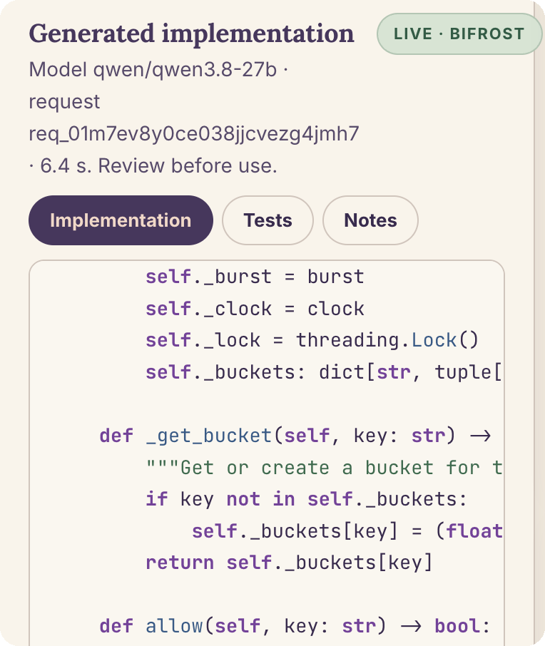
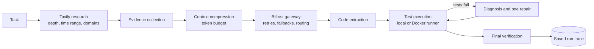
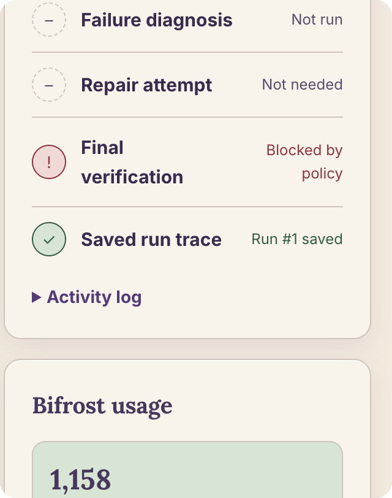

# FreshCode AI — v5.1

[](https://github.com/Pavan3030-pr/FreshCodeAi/actions/workflows/ci.yml)


**Fresh context, lean tokens, verified code.** A coding agent that researches current documentation with **Tavily**, compresses the evidence to a token budget, generates code through the **Bifrost** gateway, then tests, diagnoses and repairs it, and saves a trace of every step.

**Live demo:** https://freshcodeai.onrender.com · **Judge walkthrough:** [docs/JUDGE_DEMO.md](docs/JUDGE_DEMO.md)



## Why it exists
AI coding help fails in three ways: it answers from **stale** knowledge, it wastes **tokens** on unfiltered context, and its output is **unchecked**. FreshCode AI addresses each one in a single loop.

## How it works


| Challenge | What FreshCode AI does |
|---|---|
| **Coding agent** | 11 visible stages from task to verified code; failed tests trigger a diagnosis and a repair attempt; every run is saved with its trace, token report and Markdown export. |
| **Tavily: stale-answer detector** | Extracts change-sensitive claims, retrieves current sources, flags newer versions (e.g. "FastAPI 0.100 is the latest") and suggests corrections. Search depth, topic, freshness window and domain filters are configurable. Also available as a [CLI](#stale-answer-cli). |
| **Bifrost gateway** | One OpenAI-compatible endpoint with timeouts, retries with backoff and a fallback model. Against a real Bifrost gateway it can send a virtual key, request server-side fallbacks, and records which provider and model actually served each call. |



## Try it in 60 seconds
```bash
git clone https://github.com/Pavan3030-pr/FreshCodeAi.git && cd FreshCodeAi
python3 -m venv .venv && source .venv/bin/activate
pip install -r requirements-dev.txt
cp .env.example .env           # keys are optional: the guest demo works without them
uvicorn app.main:app --reload --port 8000
```
Open http://localhost:8000. Add `BIFROST_API_KEY` and `TAVILY_API_KEY` to `.env` (then restart) for live runs.

## Stale-answer CLI
```bash
python scripts/stale_check.py answer.txt          # Markdown report
python scripts/stale_check.py answer.txt --fix    # text with suggested version corrections
python scripts/stale_check.py answer.txt --json
```
Exit code `1` when stale or contradicted claims are found, so it can fail a CI job when documentation goes out of date. Needs `TAVILY_API_KEY`.

## Provider tuning (all optional)
| Variable | Effect |
|---|---|
| `TAVILY_SEARCH_DEPTH` | `basic` (default) or `advanced` (better snippets, more credits) |
| `TAVILY_TIME_RANGE` | `day`, `week`, `month` or `year`: only sources published or updated in that window |
| `TAVILY_TOPIC` | `general` (default) or `news` |
| `TAVILY_INCLUDE_DOMAINS` / `TAVILY_EXCLUDE_DOMAINS` | Comma-separated domains, e.g. `docs.python.org,fastapi.tiangolo.com` |
| `BIFROST_VIRTUAL_KEY` | Sent as `x-bf-vk` for Bifrost budgets, rate limits and routing rules |
| `BIFROST_NATIVE_FALLBACKS` | `1` to send the request `fallbacks` array (needs a real Bifrost gateway and a `provider/model` fallback) |

**New in v5.1:** a warm, colour-rich light design system (lavender, lilac, peach, sage, sand, cream, plum), a three-region Engineering Agent with an 11-stage execution trace, syntax-highlighted code with copy/download, measured-vs-estimated token labels, a collapsible sidebar and mobile drawer, a rebuilt landing page and sign-in. Dark mode was removed. See [the v5.1 release report](docs/V5_1_RELEASE_REPORT.md).

Public site (`/`), sign-in (`/login`), and the authenticated workspace (`/app`): Overview · Projects · Engineering agent · Freshness · Evaluation lab · History & reports · Test lab · Integrations · Account (profile, security, usage, audit, preferences).

## Setup

**macOS / Linux**
```bash
python3 -m venv .venv && source .venv/bin/activate
pip install -r requirements-dev.txt
cp .env.example .env        # add keys; everything is optional for the guest demo
uvicorn app.main:app --reload --port 8000
```
**Windows (PowerShell)**
```powershell
py -m venv .venv; .venv\Scripts\Activate.ps1
pip install -r requirements-dev.txt
copy .env.example .env
uvicorn app.main:app --reload --port 8000
```
Open http://localhost:8000. The first account you create becomes the administrator. Docs: `/api/v1/docs`.

## Verify it
```bash
make test && make doctor      # (no make on Windows: python -m pytest -q ; node --test tests/js/*.test.js ; python scripts/preflight.py)
python -m playwright install chromium && make e2e
make record                   # videos, screenshots, trace and report under artifacts/
make live                     # with real keys: verifies Bifrost + Tavily, writes docs/live-results.json
make deploycheck && make audit
```

## Environment variables
See `.env.example` (all documented, placeholders only). Key groups: providers (`BIFROST_*`, `TAVILY_API_KEY`), accounts (`ALLOW_REGISTRATION`, `SESSION_*`, `COOKIE_SECURE`, `LOGIN_*`), limits (`RATE_LIMIT_*`, `DAILY_RUN_QUOTA`, `AGENT_TIMEOUT_SECONDS`), execution (`RUNNER_MODE=off|local|docker`), storage (`DB_PATH`).

## Documentation
[Architecture](docs/ARCHITECTURE.md) · [Database](docs/DATABASE.md) · [API](docs/API.md) · [Security](docs/SECURITY.md) · [Deployment](docs/DEPLOYMENT.md) · [Testing](docs/TESTING.md) · [Judge demo](docs/JUDGE_DEMO.md) · [v5.1 audit](docs/V5_1_AUDIT.md) · [UI/UX review](docs/V5_1_UI_UX_REVIEW.md) · [Test evidence](docs/V5_1_TEST_EVIDENCE.md) · [Release report](docs/V5_1_RELEASE_REPORT.md) · [Changelog](CHANGELOG.md) · [Contributing](CONTRIBUTING.md)

## Known limitations (stated plainly)
- **PostgreSQL is not implemented.** Persistence is SQLite (WAL) with versioned migrations and portable SQL.
- **The local code runner is not a sandbox.** Container isolation (`RUNNER_MODE=docker`) is implemented and its command is unit-tested, but was not run in the development sandbox (no Docker there). Public deployments should keep execution off.
- Benchmarks compare provider-reported **input** tokens on small paired samples (directional); output tokens, answer quality and correctness are not compared; no significance test. Multiple-model and context-budget comparison grids are not implemented.
- Claim extraction and version-drift detection are heuristics; verdicts from the LLM assessor need Bifrost. Confirm on official sources.
- No MFA, email verification or password-reset email; login throttling is in memory; no Notifications page and no pricing page (not meaningful for this release).
- The Freshness page has no separate "technical topic" field; Evaluation Lab bars are plain HTML, not a charting library; fonts are Latin subsets.
- Live Bifrost/Tavily behaviour is verified only by `make live` with your keys.

License: MIT.
